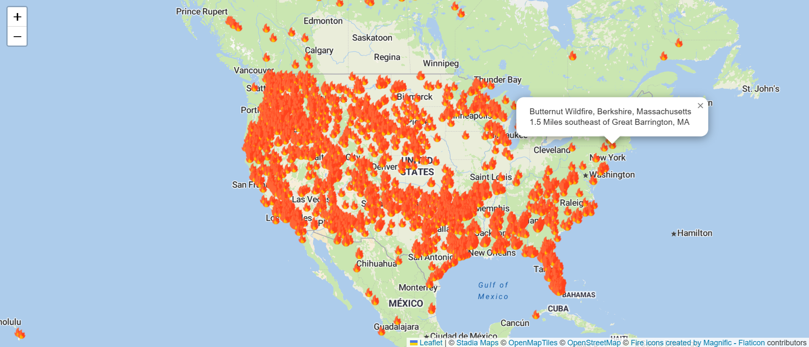

# [Wildfire Tracker](https://wildfire-webapp-ghm1.vercel.app/)
---
A website that tracks active wildfies in near real-time
---

---
## Features
- Interactive map of active wildfires
- Click fire icons for location and desciption from NASA EONET API
---
## Tech Stack 
- React
- Leaflet
- Node.js
- **API's**: NASA EONET, Stadia Maps
  
